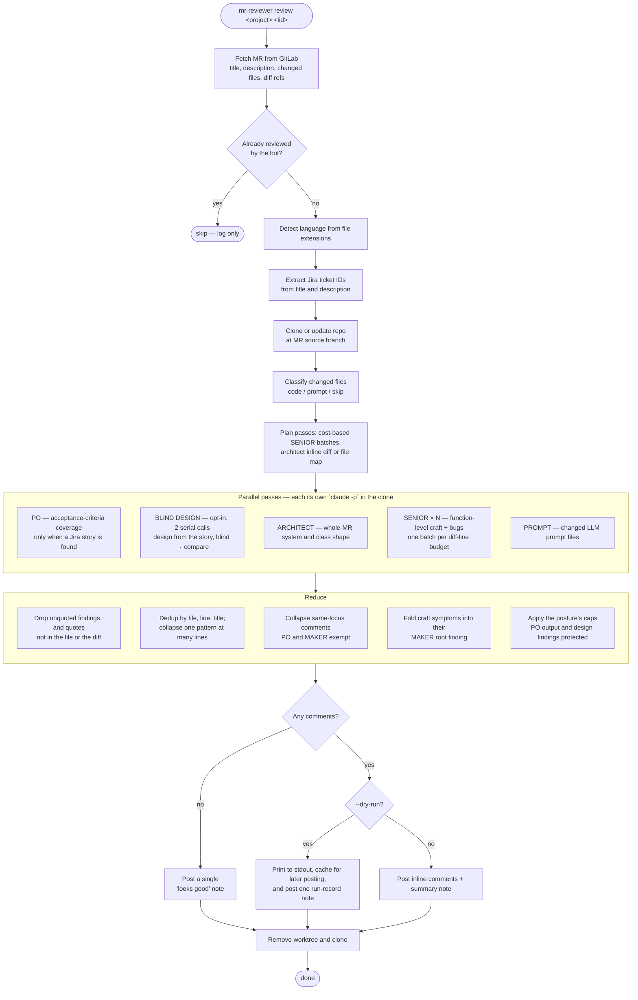

# MR Reviewer

Automated GitLab Merge Request code review powered by Claude AI.

## Features

- **A team of focused passes, not one prompt**: Product Owner, Architect, batched Senior Developer,
  prompt review, and the opt-in MAKER design pass, each its own `claude -p` call, merged afterwards
- **Independent design review** (MAKER): designs the change from the story in a pre-change checkout,
  then diffs that design against what was built — the only pass that can catch a wrong *decision*
- **Full codebase access**: clones the repo and gives Claude `Read` / `Glob` / `Grep`, so findings
  cite real files rather than guessing from a diff hunk
- **Deterministic coverage**: changed code is packed into cost-based batches, so every file is
  reviewed instead of the back half being lost to a long prompt
- **Design charter**: reviews against documented principles
  (`plugins/mr-review/charter/design_principles.md`) rather than ad-hoc taste
- **Claude Code Integration**: uses your local Claude Code CLI by default (no API key needed)
- **Batch Review**: review every open MR assigned to you, in parallel, with one command
- **Language-Specific Prompts**: tailored criteria for Java (Spring Boot), Angular/TypeScript, React,
  and Python, plus a dedicated pass for changed LLM prompt files
- **Inline Comments**: posted on the relevant lines, with a summary note on the MR
- **Bounded volume, decided once**: every pass reviews at full depth and emits candidates; one
  deterministic reducer — shared with the skill — dedupes, collapses patterns, folds symptoms into
  the decision that caused them and applies the run's posture (`mr` when posting, `high` under
  `--dry-run`, `brutal` on request), with acceptance-criteria and design findings protected from
  being crowded out by bug reports
- **Reviewable before the MR exists**: the `mr-review` plugin ships a `/review-changes` skill that
  reviews your local branch **one function per isolated subagent**, against the same charter — and
  posts nothing
- **No Nitpicking**: formatting, naming style, and log wording are explicitly out of scope
- **Skip Already Reviewed**: reruns are safe; already-reviewed MRs are skipped

## How a Single MR Is Reviewed

Clone mode is the standard path: the repo is cloned at the MR branch and each review pass runs as its
own `claude -p` subprocess with `Read`, `Glob`, and `Grep` over the working tree. Passes run in
parallel and are merged by a reduce step. Splitting them matters because a single mega-prompt
front-loads its attention and quietly under-reviews the back half of a large MR — batching the
file-level pass is what makes coverage deterministic.



Notes on the flow:

- **Skip check** (`has_bot_reviewed`) looks for a previously posted bot marker in the MR notes, so
  rerunning the tool is safe and won't double-review. `--include-reviewed` overrides it.
- **PO pass** runs only when a Jira ticket is found. It classifies the MR as FULL or PARTIAL scope
  first, then maps each in-scope acceptance criterion to addressed / partial / missing — partial and
  missing get inline comments, the rest roll up into one note. Its output is protected from the global
  cap, because those roll-ups are SUGGESTION-tier and a bug-heavy MR would otherwise discard the whole
  pass.
- **SENIOR batching is cost-based**, not file-count based: a file's cost is its diff lines plus a small
  fixed overhead, so many tiny changes share a batch while a large change goes solo. Every code file
  lands in exactly one batch.
- **ARCHITECT gets the full diff inline** for MRs under ~1500 diff lines, and a changed-file map plus
  tools above that, so it keeps whole-MR breadth without being truncated.
- **Volume is decided in exactly one place**, the reduce step, from the run's posture. The prompts
  ask for candidates and the parser bounds a single pass only by a runaway guard, so nothing is
  thrown away before dedup can tell which findings were the same finding twice. CRITICAL and WARNING
  findings are never dropped to hit a cap.
- **The clone is per-branch and deleted after each review** to avoid cache bloat.

## The blind design pass (opt-in)

Every other pass reads the code that exists and asks whether it is correct, well-shaped, and
readable. That finds local defects but cannot find a *wrong root decision*, because a wrong root
decision doesn't look like a smell — it looks like clean, well-named code implementing the wrong
thing, and it's invisible without an alternative to compare against.

This pass supplies the alternative in two calls:

1. **Design** (`charter/blind_design.md`) — runs in a `git archive` extract of the pre-change
   commit, so the implementation is physically absent rather than merely off-limits. An archive
   rather than a worktree, because a worktree carries the object database and a curious agent
   reaches the branch it is supposed to be blind to with one `git log`. It gets the **story and
   nothing else** — the MR title, description and diff all narrate the chosen implementation, so
   all three are withheld — then reads prior art and produces a short sketch: which tier does the
   work, what types cross each boundary, which principles the design turns on, and a few lines
   *proving* the alternative can actually be built. It deliberately does not write the
   implementation, because a parallel implementation would make the next call diff hundreds of
   lines and report style differences.
2. **Compare** (`charter/blind_compare.md`) — the only pass that knows what the alternative was. It
   reports a divergence only when the cost can be named concretely, and posts **one comment per
   root decision**, listing the symptoms that decision causes.

There used to be a triage call in front of these, naming the mechanisms worth designing. It was
removed because it scoped the design from the *diff*: the mechanisms it named were the
implementation's own decomposition restated in requirement language, so the design call could ask
whether each one should exist while never asking whether the change was carved up the right way.
Scope now comes from the forks the acceptance criteria leave open, which is why the pass skips
itself when the MR has no Jira story.

Both calls are large, so the pass is gated to cost nothing where it can't pay. A free structural
scan of the added diff lines runs first — abstractions introduced, untyped bags at a boundary,
runtime type interrogation, bulk data transforms, manufactured null sentinels, suppressed quality
gates, migration-shaped paths — and on a 39-file MR it selects 9 files, while a field-widening or
test-only MR selects none. Test sources never count towards the gate.

Findings post as `🔷 REDESIGN` and are counted separately in the summary. On a real MR it collapsed
five separate human review comments — an in-memory collection load, an `instanceof` traversal, an
`Object` local, and two unnecessary abstractions — into one finding naming the decision that caused
all of them.

Both calls read `plugins/mr-review/charter/design_principles.md`, a charter organised by information hiding,
responsibility and boundaries, abstractions and wrong abstractions, domain modelling, OOP/FP, design
patterns and their absence, imperative-versus-declarative, and unnecessary complexity and verbosity.
It ends with a 15-question review checklist.

## Learning mode (`--learn`)

A review and a lesson are different artifacts. The review is organised by **location** — a comment
sits where the problem is, says the minimum needed to act on it, and assumes you already know what
"anemic domain model" means. That is right for someone who knows the principles and has to ship today.
It is wrong for someone learning, and not slightly wrong: the concept is scattered across five
comments, the name is used without being taught, and everything below the review's noise bar was
dropped — when what a senior calls a nit is often exactly the teachable moment.

`--learn` inverts those choices and produces two things.

**Every posted comment teaches.** After the review merges, each finding with a concept behind it gets
an addendum appended below it:

```
🟡 WARNING: mapPresent and mapSpecifications are identical duplicates
   ... the existing finding ...

---
📚 **Concept: Wrong abstraction (Metz)**

**Why it costs:** two names imply two behaviours, so the next reader has to diff them character by
character to learn they are interchangeable — and a fix applied to one silently misses the other.

**The rule:** duplication is cheaper than the wrong abstraction. Consolidate at the second
occurrence only when the two sites would *have to* change together. Read: Metz, *The Wrong
Abstraction*.

**Spot it next time:** two helpers with different names and identical bodies, or a parameter that
exists so one caller can skip part of a shared method.
```

The addendum is appended, never a rewrite, so it cannot damage a finding the review already got
right. Findings with nothing to teach — a mistyped constant, an off-by-one — are left alone, and a
concept's second and third instance get a one-line cross-reference rather than a repeat.

**And a study document is written**, because a comment can teach in context but cannot group, rank, or
point onward:

- **Caps are lifted for the document.** The per-file cap and the root-cause absorption exist to
  protect a reviewer's attention, and each one removes teaching material. Absorption is the
  interesting one: folding an untyped local, a runtime type check, and a hand-rolled traversal into
  one root finding is what makes the review terse — and those symptoms are the recognisable surface a
  developer learns to spot, so the lesson needs them back.
- **It is organised by concept, not by file.** Four findings sharing one concept become one section
  with four examples, and the recurrence is itself the lesson.
- **Every example is your own code.** Textbook examples are what books are for; the value here is that
  the code is yours.

Each concept gets the canonical name (so you can search it, read about it, and argue about it), the
mechanism of what it actually costs, the better shape written out, a tell for spotting it next time, a
self-check question, and a pointer to an existing example *in this repository* of the idea done well.
The document opens with what the change got right — each item named with the principle it exemplifies
— and ends with the single concept worth internalising first, because learning six things at once
means learning none.

```shell
# Study document for one MR, with the design pass on for richer material
.venv/bin/mr-reviewer review -p my-group/my-service -m 470 --learn --enable-maker

# Or via the environment
MR_REVIEWER_LEARN=1 .venv/bin/mr-reviewer review --url "..."
```

The document is written to `mr-learning-<project>-<iid>.md` in the current directory (gitignored) and
printed to stdout. Comments are posted as usual — add `--dry-run` to preview them first, which is
worth doing the first time.

**The MR thread stays a normal size.** Learning mode changes what each comment *says*, not how many
are posted: the usual global cap still applies at the posting step, because a junior's MR buried under
forty threads teaches nothing. The full breadth goes into the document instead, where nobody has to
read or resolve it.

Two extra Claude calls on top of the review — one to write the addenda, one for the document.

## Reviewing your own changes (`/review-changes`)

The CLI reviews **merge requests**: unattended, in batch, posting to the thread. The plugin in
`plugins/mr-review/` covers the other half of the problem — reviewing the code **before** the MR
exists, while the feedback is still cheap to act on. By the time an MR is open the code is
already someone else's problem.

```shell
# once per machine
/plugin marketplace add sujeet100/mr-reviewer
/plugin install mr-review@mr-reviewer

# then, from inside any repo
/review-changes                      # this branch's work, including uncommitted
/review-changes --quick              # pre-commit look: sonnet craft, ≤4 agents, no questions
/review-changes --deep               # before a risky merge: the default passes plus the design pass
/review-changes --plan               # what it would review and cost; spends at most 1 cheap agent
/review-changes --staged             # only what is staged
/review-changes --base main          # everything since main
/review-changes --yes                # take the recommended passes, no questions
/review-changes --maker --po         # add the design and acceptance-criteria passes
/review-changes --only craft --max-agents 6    # cheapest useful review
/review-changes --brutal --fast      # every finding that clears the bar, cheaper model
```

It needs nothing installed — no Poetry, no `.env`, no `GITLAB_TOKEN`, no API key, not even
`glab`. It is **read-only**: it posts nowhere and edits nothing, by design, because there is
usually no MR to post to and the working tree it is reading may hold uncommitted work.

### Five reviewers, five questions

Each pass answers one question, and the questions do not overlap. That separation is the design:
a reviewer asked to find bugs and craft and shape at once reads in the register of whichever it
saw last.

| Pass | Question | Default |
|---|---|---|
| **Craft** | Is the implementation locally good? One agent per file, each changed function read with the whole file as context. | on |
| **Architect** | Is the structure good? Class and module responsibilities, boundaries, abstractions. | on when the change has shape to look at |
| **Integration** | Does the change behave correctly as a system? Contracts under their callers, behaviour spread across files, transaction and failure paths, changed functions nothing tests. | on when there is something to integrate |
| **Design** (MAKER) | Was this the right solution? Designs an alternative blind, then compares. | `--maker` / `--deep` |
| **Acceptance criteria** (PO) | Does it do what the story asked? | `--po` |

Integration is the pass that was missing. Craft is deliberately local and Architect is
deliberately about shape, so before it existed a method that started returning an empty list
while a caller in another file still checked for `null`, or a write that drifted outside the
transaction that used to enclose it, was nobody's job.

### The mapper decides the facts, and computes the change context

`plugins/mr-review/scripts/changed_functions.py` runs first and costs nothing. It maps every
changed line to its enclosing function (`ast` for Python, a signature-and-brace scan for Java,
Kotlin, TypeScript, Go and friends), including lines that were only deleted, and then computes
what every reviewer would otherwise re-derive with its own greps:

- **tags** from the changed lines — persistence, concurrency, authz, money, retry/cache, external
  boundary, and `public_api` when a changed signature has three or more callers — each of which
  appends a short lens file to the prompts that need it;
- **callers** of every changed production function, from one `git grep`, with the count in tests;
- **coupling** between changed functions, so a helper and its caller in one file share a card;
- **triviality**: an edit whose every line is plumbing (imports, declarations, comments) or a
  rename applied throughout is **set aside** and listed as not reviewed, rather than costing an
  Opus agent;
- **signals** per pass — the reasons Architect, Integration and MAKER have something to look at —
  so a one-file, one-function change skips the wide passes and the report says why.

### Review cards and agent invocations are different things

Conflating them was the original design error, and it was expensive in both directions. Sized as
one object, a coherent fourteen-line change had to spend a whole agent — paying ~12k tokens of
re-read charter to look at fourteen lines — while a 352-line new test module got shredded into
twelve agents that never saw each other's half of the file.

So the mapper produces **cards** first, sized for coherence with no regard for cost. A card is
always inside one file, and its `kind` says why those units are one thing to judge:

| Kind | What it is | How it is reviewed |
|---|---|---|
| `new-file` | a file that is mostly new — it *is* the change | read whole, judged as one artifact |
| `suite` | a test file | as a suite: fixtures, shared setup, naming, duplication between cases |
| `class` | one class's changed methods | each method in turn |
| `region` | module-level changed code | each region in turn |

It then **packs** cards into agent invocations, bounded by lines to read, card count, changed
lines and changed symbols. An invocation may span files, and the brief tells the agent plainly
that its cards are independent and that a finding must not span them — that instruction is what
makes packing safe, since the register shift the old never-span-files rule guarded against came
from holding several files of deep reading, not from glancing at a few small targets.

Reading is bounded too: a card is read whole only when at least half the file changed, and
otherwise as its changed spans plus surrounding context. On a large reference MR (68 files, 2,671
insertions) the old one-agent-per-batch shape produced **76 agents reading 22,297 lines to review
1,459 changed ones**, because every batch of a file re-read all of it. The same change now maps to
**38 cards in 16 agents reading 4,560 lines**, mean 285 and max 592 lines per agent, with all 207
changed functions still covered.

It writes one `context.txt` for the wide passes and one `batch-N.txt` brief per craft agent, so
the orchestrator hands agents a path instead of transcribing unit lists into prompts. `context.txt`
also carries a **change map** — the whole change's files, symbols and changed-function call links
— so an agent reviewing one card is still oriented in the change around it. Everything in those
files is fact — spans, call sites, tags — never a finding or a hypothesis, because independence of
*judgement* is the point of running these agents separately, while isolation from factual context
never was.

```
changed_functions.py  ->  units -> cards -> invocations, context.txt, batch-N.txt, signals
        |
Wave 0, all at once: [triage if the plan exceeds the budget] · ARCHITECT · INTEGRATION · PO · MAKER
        |
        --select <ids> --fallback <ids> -> batches in triage order, budget spent in AGENTS
        |
Wave A: one craft agent per invocation (several cards each), <= 8 concurrent
        |
merge_findings.py: parse, drop unquoted, dedup, collapse patterns, [calm caps], rank
        |
report: orientation · top three · the full list · what was not covered, and why
```

### It asks before it spends

With no flags, the skill runs the mapper first and then asks which passes to run **with the real
numbers in front of you** — the card and invocation counts for craft, and the signals (or their absence) for
Architect and Integration:

```
Which review passes?                        (multi-select)
  [x] Craft — maintainability review         38 cards in 16 agents for this change
  [x] Architect — whole-change shape         3 production files changed; new class in PricingPolicy.java
  [x] Integration — works as a system        signature of quote() changed, 7 call sites; 2 functions untested
  [ ] Design — build an alternative, compare 2 serial agents

How deep, and what should it cost?          (single select)
  (•) Standard — Opus, up to 12 agents
  ( ) Quick — Sonnet craft, up to 4 agents
  ( ) Cover everything — pack all functions into the budget
  ( ) Plan only — show me what it would review, then stop
```

Any explicit flag skips the question, as do the presets. Selecting no passes stops the run rather
than quietly falling back to the defaults.

### Keeping the cost honest

| | Default | Cost |
|---|---|---|
| Triage | automatic — only when the plan has more invocations than the budget | 1 `sonnet` agent |
| Craft | on | 1 `opus` agent per invocation (several cards each) |
| Architect | on when signalled | 1 `opus` agent |
| Integration | on when signalled | 1 `opus` agent |
| Design (`--maker`) | **off** | **2 serial agents** |
| Acceptance criteria (`--po`) | **off** | 1 agent + a Jira fetch |

`--max-agents` (default 12) is a hard ceiling, with the wide passes coming off the top and craft
taking the remainder; a pass the signals switch off gives its agent back to craft. The budget is
spent in **agents**: when triage ranks the units, the mapper packs its selection into cards in
triage's order and fills any agents left idle from the top of triage's deprioritised list, and
the report names those refilled units. Invocations are sized by **what the agent must read**,
because that is what costs and what degrades review quality — not by changed-line count, since
ten changed lines inside a 500-line method cost more attention than sixty across four short ones.

When the change is bigger than the budget there are two honest responses, and the skill makes you
pick. The default keeps invocations within their read budget, lets triage rank them, reviews the
top of the list properly and **reports the rest as unreviewed**. `--fit <n>` instead packs
everything into `n` agents by relaxing the budgets, which degrades faster than it looks; measured
on a large reference MR, whose natural size is 16 invocations:

| Budget | Agents | Cards per agent (mean / max) | Lines read per agent (mean / max) |
|---|---|---|---|
| `--fit 3` | 3 | 13 / **26** | 1520 / **2822** |
| `--fit 5` | 5 | 8 / **14** | 912 / **1974** |
| `--fit 10` | 9 | 4 / 10 | 507 / 1023 |
| *(no `--fit`)* | 16 | 2 / 5 | 285 / 592 |

`--quick` and `--deep` are compositions of these flags for the two questions developers actually
ask — "did I just break something obvious?" and "is this safe to merge?" — not different reviews.
Note that posture is *not* a cost control: `--brutal` changes what the reducer keeps, not how many
passes run.

### The merge is a script, not a judgement

`plugins/mr-review/scripts/merge_findings.py` takes every agent's raw output and does,
deterministically and with fixtures, what an earlier version asked the orchestrating model to do
by eye: parse each output leniently, drop malformed findings, **drop any finding whose quoted code
is not in the cited file or the diff**, dedupe exact repeats, collapse one pattern reported at
many lines into one finding that lists every location, fold craft symptoms into the design finding
that explains them, and apply the posture's caps. It never decides whether a finding is *right*. That was tried — the CLI's verification pass asked a
model to "re-evaluate strictly" and "be ruthless" — and it over-pruned exactly the craft findings
the review exists to produce, because a craft finding has no fact a second model can check. The
one content-based drop here is "the code you quoted is not there", which is the class of finding
developers most often push back on, and every drop is listed in the report with its reason.

### Reading the review

The terminal report lists every finding with its `path:line` on its own line — which VS Code's
and IntelliJ's terminals turn into a link — and a two-line excerpt of the anchor, so most
findings can be judged without opening the file. Alongside it the skill writes one
self-contained HTML page under `/tmp` and opens it: the diff, one section per file, with each
finding rendered as a card directly under the line it anchors to, the way a merge-request view
would show a comment. Findings the architect or integration pass anchors outside the hunks get a
few lines of working-tree context instead of being lost. The header carries the counts and
filters by severity and pass; every card has links that open the file at that line in VS Code
(`vscode://`) or IntelliJ (`idea://`), and a **valid / invalid / duplicate** label kept in the
browser per review title, with an export button. Those labels are the precision data the
benchmark needs, so every review you read is also a measurement.

The page is a **local file by decision**. It contains the repository's diff and quoted code, so
it never leaves the machine unless you choose to send it; publishing it as a hosted page was
considered and rejected as a default. For anyone who prefers the IDE's own problems view, the
same script also emits SARIF (VS Code's SARIF Viewer extension) and IntelliJ inspection XML
(*Code › Analyze Code › View Offline Inspection Results*), and it reads the CLI's dry-run cache,
so a `--dry-run` of a real MR can be read the same way before `--post-cached`:

```shell
python3 plugins/mr-review/scripts/render_review.py --repo <clone> --diff mr.diff \
  --merged ~/.cache/mr-reviewer/reviews/<project>-<iid>.json --out /tmp/mr-<iid>.html
```

### Every pass runs in a clean context

Each pass is a **fresh subagent**, never a fork of the calling session, and that isolation is
the point rather than an implementation detail. The session invoking the skill is usually the
session that just *wrote* the code: it holds the intent behind every decision and the reasoning
that already justified the awkward part. A reviewer holding all that reads the name it meant
instead of the name that is there. So the orchestrating session does plumbing only — resolve the
scope, launch the agents, run the reducer, report — and Craft, Architect and Integration never
see each other's output.

### Which model runs which pass

| Pass | Model | Why |
|---|---|---|
| Per-function craft | `opus` (`sonnet` with `--fast` / `--quick`) | The hardest judgement here — naming a smell precisely, and holding the line between a real finding and a nitpick |
| ARCHITECT | `opus` | Whole-change shape, boundaries, whether an abstraction earns its place |
| INTEGRATION | `opus` | Holds the change and its callers, tests and boundaries together and names a concrete sequence |
| MAKER — triage | `haiku` | A cheap gate that returns `[]` on most changes |
| MAKER — design | `fable` | Designs rather than reviews, from the requirement with the implementation absent |
| MAKER — compare | `opus` | Holds its own design and the real code side by side and names what the divergence costs |
| PO | `sonnet` | Structured verification against the story |
| Triage | `sonnet` | Ranking risk needs judgement but not the deepest kind, and it only runs when ranking changes what gets reviewed |

### What each pass reads

The craft agent reads `function_review.md` and `craft_lens.md` — the house charter's
function-level half, extracted so a reviewer holding one method is not handed twenty pages that
open with object modelling and module boundaries — plus the language file and any lens files its
brief names. Architect reads `base.md`, its own `stage_architect.md` and `design_principles.md`.
Integration reads `integration.md` and the lenses the change's tags call for. The stage bodies in
`base.md` were split into `stage_po.md`, `stage_architect.md` and `stage_senior.md` for exactly
this; the CLI splices them back into one prompt, so there is still one copy of every rule.
Every pass that produces a finding also reads `writing.md`, which fixes how a finding is written:
the problem first with the lines quoted, then why it matters, then the smallest reasonable fix,
in short plain sentences and usually under 150 words. The CLI appends the same file to its
prompt, so posted MR comments follow it too.

Run the mapper standalone to see the plan, the context and the agent count before spending
anything:

```shell
python3 plugins/mr-review/scripts/changed_functions.py                        # plan for the default scope
python3 plugins/mr-review/scripts/changed_functions.py --briefs-dir /tmp/b    # plus context.txt and briefs
python3 plugins/mr-review/scripts/changed_functions.py --max-batches 6        # tighter agent budget
python3 plugins/mr-review/scripts/changed_functions.py --max-read 900         # bigger invocations, fewer agents
python3 plugins/mr-review/scripts/changed_functions.py --base X --head Y      # a committed range, read at Y
python3 plugins/mr-review/scripts/changed_functions.py --include-trivial      # review mechanical edits too
python3 plugins/mr-review/scripts/changed_functions.py --self-test
python3 plugins/mr-review/scripts/merge_findings.py --self-test
```

## Model and reasoning effort per pass

Each pass runs on the model and effort its job needs, rather than one setting for the whole run.
Effort multiplies output tokens, so it is spent where a pass must derive a consequence from
several facts and withheld where the pass is classification.

| Pass | Model | Effort | Why |
|---|---|---|---|
| PO | `sonnet` | `medium` | Walk the criteria, find the evidence, classify |
| ARCHITECT | `opus` | `high` | One call, whole-change shape, most leverage per call |
| SENIOR (craft) | `opus` | `medium` | The most numerous pass, so its effort is the largest single cost in the run |
| PROMPT | `opus` | `medium` | |
| BLIND DESIGN/design | `fable` | `medium` | Generative planning, not review |
| BLIND DESIGN/compare | `opus` | `high` | Holds two designs side by side and prices the divergence |

The CLI's blind design pass has no triage call, so there is no level for one; the skill's own
triage runs on `sonnet`. The names above are the labels the call sites pass, and they have to match
`EFFORT_BY_STAGE` exactly — the lookup is a `.get`, so a key that matches nothing hands the pass no
level at all and it quietly inherits whatever the session is set to.

The split follows whether a pass has a checkable answer. PO and triage do — a
criterion is either evidenced or it isn't — so a wrong answer there is visible and bounded. Craft,
ARCHITECT and `BLIND DESIGN/compare` have no ground truth, and the merge step is forbidden from judging
whether a finding is right, so for those the generating model is the only filter between a real
smell and confident noise.

The levels live in `EFFORT_BY_STAGE` in `mr_reviewer/reviewer.py`. They are **hypotheses, not
measurements**: nobody has yet compared Sonnet-at-high against Opus-at-medium for the same spend,
and that is the first thing a seeded-defect benchmark should settle. `--effort <level>` overrides
all of them for one run; omit it and a pass with no mapped level inherits the ambient session
level. `--effort` has no effect on the deprecated `--use-api` path, which talks to the Anthropic
SDK rather than `claude -p`.

Note that the skill (`/review-changes`) assigns **models** per pass but not effort: the Agent tool
takes no effort parameter, so every skill pass runs at the session's level. Per-pass effort there
would need each pass declared as a subagent definition with an `effort` field.

## Review posture — how much of what was found gets reported

Every pass reviews at full depth and emits **candidates**; a deterministic reducer
(`plugins/mr-review/scripts/merge_findings.py`) then applies the run's posture. Detection and
presentation are separate on purpose. A quieter *reviewer* loses the subtle findings this review
exists to produce, and loses them irrecoverably; a quieter *report* loses nothing, because every
suppressed finding is still in the merged output alongside the cap that removed it.

There is one table of numbers and both consumers read it:

| Tier | The question it asks | Default for | Craft per file | ARCH / INT / DESIGN / PROMPT | Global ceiling |
|---|---|---|---|---|---|
| `mr` | Is this important enough to interrupt the author's MR thread with? | the CLI, when posting | 2 | 6 / 6 / 2 / 4 | 6 at 5 units → 10 at 25 → 14 from 55 up |
| `high` | Would a strong senior raise this while pairing, before the MR? | the skill; the CLI under `--dry-run` | 4 | 12 / 10 / 4 / 6 | 14 → 40, by √units |
| `brutal` | If you asked for everything meaningful, would fixing this materially improve the code? | `--brutal` | none | none | none (and symptoms stay standalone) |

The CLI's `--post-cached` caps a cached `--dry-run` review down to the `mr` tier before posting it,
rather than putting a report-tier list into a shared thread.

The tier is chosen by **who reads the result**, never by what the run cost. A posted comment spends
the author's attention whether or not they agree with it; a `--dry-run` report is read by the person
who asked for it and nobody else, so the etiquette that keeps a shared thread short does not apply.

The writing bar below is the one thing no posture lifts, because demoting an over-proved body and
keeping a 300-word one off a diff line hide nothing — the finding is in the output either way.

**What never moves with posture.** The quote check, the file check, the no-hedging rule, the
bug-class evidence gates (a concrete input, a concrete path, a concrete wrong result) and every
false-positive guard run identically at all three tiers, and dedup runs at all three because two
copies of one finding are not two findings. No pass reads a different prompt per tier. Nor do the
structural budgets — batch sizes, concurrency, read limits — move: those bound *attention per call*,
not output volume, and lifting them would make the review worse rather than more thorough.

**A caveat worth knowing before you reach for `--brutal`.** Caps were never the main thing bounding
this review's volume. The global ceiling has always refused to drop CRITICAL or WARNING findings — it
only ever trimmed optional suggestions — and an experiment with every cap patched off returned five
findings where a human had made twelve comments. The binding constraint is what the prompts
*generate*. That is why every pass is now asked for candidates on **every** run (`charter/candidates.md`,
appended after the budgets it lifts) rather than only under `--brutal`; the flag changes no prompt at
all any more. If you want more function-level findings specifically, the bigger lever is the skill's
per-function pass.

```shell
# see everything, post nothing
.venv/bin/mr-reviewer review --url <mr-url> --brutal --dry-run

# everything, with the design pass and the concept teaching as well
.venv/bin/mr-reviewer review --url <mr-url> --brutal --enable-maker --learn --dry-run

# scripted
MR_REVIEWER_BRUTAL=1 .venv/bin/mr-reviewer review-all --dry-run
```

`--brutal` adds no Claude calls — it only stops the reduce step discarding findings the passes
already produced — so it costs no extra time. When combined with `--learn`, brutal wins: the
posting-step cap learning mode normally applies becomes the brutal tier, because asking for
everything is explicit.

### Roots and their symptoms

A wrong decision shows up as several small findings: an untyped local here, a runtime type check
there, a helper extracted from a loop that should not exist. Posted separately they read as
nitpicks and every volume bound correctly trims them; posted as one comment that names them, they
justify reshaping the code. So a design or ARCHITECT finding absorbs the lower-altitude findings
under it and lists their titles and lines.

Three rules, each of which comes from a real MR:

- **The locus is the enclosing function**, when the mapper's plan is available (`--plan`). A design
  root in one method has no business absorbing a naming problem in another. A root that sits
  outside every function — on a class declaration, say — still covers its file.
- **A root absorbs only what is below it.** Altitude order is PO, design, Architect, Integration,
  craft, so a design finding can absorb the Architect finding restating it. On one real MR it could
  not, and one coupling reached the author from three altitudes at once.
- **A bug is never absorbed.** It stays its own comment and gains one line saying where its root
  is. On another MR the "distance unit modelled three times" finding and the "silently reads unknown
  units as metres" bug were one decision and its consequence; both needed to post, and neither
  needed to be the other's footnote.

Two findings from the *same* pass on one line both survive: a pass reporting twice has found two
things, not one thing twice. Only the other passes' framings of that line collapse into the
highest-altitude one.

### The writing bar

`writing.md` asks for 40–100 words and calls anything past 150 a defective comment rather than a
thorough one. It was ignored — 26 of the 36 findings on the two MRs the architecture assessment
read ran past 150 words of prose, and the ARCHITECT and design bodies ran 200–350 — because nothing
counted. The reducer counts, and now acts on the count:

| Body length | What happens |
|---|---|
| ≤ ceiling (150, or 180 for a design / ARCHITECT finding) | nothing |
| over the ceiling | demoted one severity rank, and the count shown beside the badge |
| over 250 words | kept in the report, folded into the summary note instead of posted on a line |

The count is taken from the body **as it stands** when the bar runs, which is after a collapsed
pattern has listed its other locations and after a design root has listed its symptoms. The
demotion and its reason travel with the finding and are rendered on the page and in the markdown
list, so a badge one rank below what a reviewer wrote says why it is there.

**Nothing is dropped for length.** Losing a demonstrated bug because its author was wordy is the
worse outcome, so the bar demotes and de-lists and never rejects — the cost of over-proving is that
a good finding arrives with a quieter badge than it earned. The demotion runs *after* the caps,
deliberately: run before them, a wordy CRITICAL would become a WARNING that a stage cap could then
trim, which would make length a reason a bug disappears.

Code inside fences does not count, because a quote is evidence rather than verbosity. The ceiling
is wider for design and ARCHITECT findings because their alternative *is* the finding, while a
naming problem that takes two hundred words is padded.

### One reduce step, both consumers

The CLI and the skill share `merge_findings.py`, reached from the package through
`mr_reviewer/reduce.py`. That module converts the CLI's parsed `ReviewComment` objects into the
reducer's candidates and back, and resolves the script through the same three-candidate fallback
chain as the charter (`$MR_REVIEWER_SCRIPTS`, the plugin beside the package, the pre-move location).

It matters because the CLI used to have its own chain — a per-stage cap applied as each pass was
*parsed*, then a per-file cap, then a global cap with its own scaling — and that chain had never
gained the quote check, the file check or the pattern collapse. The consumer that actually posts was
running the weaker filter. The parse-time cap is gone entirely; a single pass is now bounded only by
a runaway guard (`RUNAWAY_GUARD = 15`, dropping lowest-severity first and warning loudly), which
marks a pass that ignored its ranking instruction rather than expressing a volume preference.

In the deprecated diff mode there is no checkout, so the reducer runs without one: quotes are
checked against the diff alone and the file check cannot run. That is weaker than clone mode and
still better than nothing — dropping every finding for a file that is merely not on disk would
silence the pass rather than filter it.

## Prerequisites

- **Claude Code CLI**: Must be installed and authenticated
  ```bash
  # Verify Claude Code is installed
  claude --version
  ```
- **GitLab Personal Access Token**: With `api` scope

## Installation

### Using Poetry (Recommended)

```bash
# Clone the repository
git clone <repo-url>
cd mr-reviewer

# Install dependencies with Poetry
poetry install

# Activate the virtual environment
poetry shell
```

### Using pip

```bash
# Clone the repository
git clone <repo-url>
cd mr-reviewer

# Create virtual environment
python -m venv venv
source venv/bin/activate  # On Windows: venv\Scripts\activate

# Install dependencies
pip install .
```

## Configuration

### Minimal Setup (Using Claude Code CLI - Default)

You only need to set your GitLab token:

```bash
# Create .env file
cp .env.example .env

# Edit .env - only GITLAB_TOKEN is required when using Claude Code CLI
GITLAB_URL=https://gitlab.com
GITLAB_TOKEN=your-gitlab-personal-access-token
```

### Configure for your organisation

Nothing about any particular company is built in. Everything that differs between organisations is
a setting, either in `config.yaml` (copy `config.example.yaml`; also searched for at
`.mr-reviewer.yaml` and `~/.config/mr-reviewer/config.yaml`) or as an environment variable, and an
environment variable always wins over the file.

| What | `config.yaml` | Environment | Default |
|---|---|---|---|
| GitLab host | `gitlab.url` | `GITLAB_URL` | `https://gitlab.com` |
| GitLab token | `gitlab.token` | `GITLAB_TOKEN` / `MR_REVIEW_BOT_TOKEN` | — (required) |
| Group prepended to short project paths | `review.default_group` | `GITLAB_DEFAULT_GROUP` | none |
| Projects `review-all` scans | `review.projects` | `--projects` | MRs assigned to you |
| Whose assigned MRs to review | `review.reviewer_username` | `--reviewer` | the token's owner |
| Jira site (empty turns Jira off) | `jira.site` | `JIRA_SITE` / `JIRA_CLOUD_ID` | none |
| Jira project keys that count as tickets | `jira.project_keys` | `JIRA_PROJECT_KEYS=PAY,CORE` | any `ABC-123` |
| Jira MCP tool name | `jira.mcp_tool` | `JIRA_MCP_TOOL` | `mcp__claude_ai_Atlassian__getJiraIssue` |
| Post a run-record note on dry runs | — | `MR_REVIEWER_RECORD_RUNS=1` | off |

Jira is read through the Atlassian MCP connector in your Claude login rather than with a token of
its own, which is why the tool name is configurable: connector names vary by account, and a second
Atlassian connection appears as `mcp__claude_ai_Atlassian_2__getJiraIssue`. Setting
`project_keys` is worth doing, because without it anything shaped like a ticket key, `SHA-256`
included, is fetched as a story. With no Jira site the PO and blind design passes skip themselves
and every other pass runs normally.

The CLI speaks to **GitLab only** (gitlab.com or self-managed). The `/review-changes` skill does not
talk to any forge at all, so it works the same in a repository hosted on GitHub, Bitbucket or
anywhere else, and it reads `JIRA_PROJECT_KEYS` and `JIRA_MCP_TOOL` from the environment too.

### Using Anthropic API (Optional)

If you prefer to use the Anthropic API directly instead of Claude Code CLI:

```bash
# .env
GITLAB_URL=https://gitlab.com
GITLAB_TOKEN=your-gitlab-personal-access-token
ANTHROPIC_API_KEY=your-anthropic-api-key  # Required only with --use-api flag
```

Then add the `--use-api` flag when running commands. Note this selects the **deprecated** diff-mode
path — see [Backends](#anthropic-api--deprecated).

### GitLab Token

Create a Personal Access Token in GitLab with `api` scope:
1. Go to GitLab → Settings → Access Tokens
2. Create a token with `api` scope
3. Save the token securely

## Usage

### Review All Pending MRs (Batch Mode)

Review all open MRs assigned to you as a reviewer:

```bash
# Review all pending MRs (uses Claude Code CLI)
mr-reviewer review-all

# Dry run - see what would be reviewed without posting
mr-reviewer review-all --dry-run

# Re-review MRs that were already reviewed
mr-reviewer review-all --include-reviewed
```

### List Pending MRs

See all MRs assigned to you for review:

```bash
mr-reviewer list
```

### Review Single MR by URL

```bash
mr-reviewer review --url "https://gitlab.com/group/repo/-/merge_requests/123"
```

### Review Single MR by Project and ID

```bash
mr-reviewer review --project "group/repo" --mr 123
```

### Dry Run (Review Locally)

```bash
mr-reviewer review --url "..." --dry-run
```

Findings are printed rather than posted inline, so the detail stays with whoever ran the review,
and nothing is written to the MR unless you opt in to [run records](#run-records).

### Run records

Set `MR_REVIEWER_RECORD_RUNS=1` and every `--dry-run` leaves exactly one note on the MR, so local
reviews can be counted alongside posted ones; a normal review folds the same counts into its usual
summary whether or not the variable is set. It is off by default, because a local run that writes
to a shared thread surprises anyone who did not ask for it, and a team that wants the measurement
can set it for everyone.

Without it a dry run leaves no trace anywhere: GitLab does not audit repository reads, so any
measurement of the tool's use can only count *posted* reviews and has to treat its coverage figures
as a floor.

The note carries a short human summary and a machine-readable trailer in an HTML comment, which does
not render:

```
## 🤖 Automated Code Review — local run

**2 critical, 2 warnings, 1 suggestion, 2 redesign** — 7 findings across 4 files.

_Reviewed locally; findings were not posted inline. Run 3 on this MR._

<!-- mr-reviewer mode=dry-run head=a1b2c3d4e5f6 run=3 total=7 critical=2 warning=2
     suggestion=1 redesign=2 mustfix=1 kind_bug=2 kind_craft=3 kind_design=2
     suggestion_craft=1 files=4 stage_po=1 stage_architect=0 stage_senior=3
     stage_maker=2 stage_prompt=1 maker=1 learn=0 -->
```

Two things about it are deliberate.

**Repeat runs append rather than overwrite**, and the note says which run it is. A second review of
the same MR is a real event, and editing one note in place would erase when each happened.

**The trailer records `stage` and `kind`**, which `ReviewComment.to_markdown()` otherwise throws
away. That erasure is why the pass responsible for a finding is unrecoverable for everything posted
before this existed; the trailer closes that gap for everything after it. There is no `nits` count,
because the reviewer has no nit severity — `suggestion_craft` is the honest nearest thing — and no
"implemented" count, because whether a finding was acted on is only knowable later, from replies and
subsequent commits.

`has_bot_reviewed` (which makes `review-all` skip already-reviewed MRs) reads `mode` from this
trailer rather than matching the heading. A local run must not suppress the real review that was
meant to follow it, and a marker note with **no** trailer predates this feature and still counts as
a posted review, so turning recording on never makes `review-all` re-review its own history.

### Force Specific Language

```bash
mr-reviewer review --url "..." --language java
```

### Enable the MAKER design pass

```bash
mr-reviewer review --url "..." --enable-maker --dry-run
```

Off by default. See [The MAKER pass](#the-maker-pass-opt-in) for what it does and what it costs.

### Use the Anthropic API instead of Claude Code CLI — ⚠️ deprecated

```bash
mr-reviewer review-all --use-api
```

This selects diff mode, which truncates large MRs, cannot browse the codebase, and disables MAKER.
Use it only where `claude -p` cannot log in, such as CI.

## Commands

| Command | Description |
|---------|-------------|
| `review-all` | Review all open MRs assigned to you as reviewer |
| `list` | List all open MRs assigned to you as reviewer |
| `review` | Review a single MR by URL or project/MR ID |

### Shared options

| Option | Description |
|--------|-------------|
| `--dry-run, -n` | Review locally: print findings instead of posting them inline. Caches the result for later posting, and posts one run-record note. Cannot be silenced |
| `--enable-maker` | Run the MAKER design pass (off by default — see below) |
| `--learn` | Learning mode: teach the concept behind each comment, and write a study document |
| `--brutal` | Report at the `brutal` posture: no craft-per-file, per-stage or global ceiling, and no symptom absorption. The evidence bar is unchanged and no prompt changes. Expect several times the usual comment count; see below |
| `--effort` | Reasoning effort for **every** pass (`low`…`max`), overriding the per-pass levels below. Also `MR_REVIEWER_EFFORT` |
| `--enable-verification` | Run the verification pass that filters weak comments (off by default; currently over-prunes good ones) |
| `--language, -l` | Force language (`java`, `angular`, `typescript`, `react`, `python`, `generic`) |
| `--config, -c` | Path to config file |
| `--no-context` | Don't fetch full file content for context |
| `--no-related-files` | Don't fetch related domain files (entities, interfaces) |
| `--max-context-lines` | Max lines per file for context (default 500) |
| `--use-api` | ⚠️ **Deprecated** — Anthropic API backend, diff mode only |
| `--no-local-clone` | ⚠️ **Deprecated** — diff mode; truncates large MRs and cannot browse the codebase |

### `review-all` only

| Option | Description |
|--------|-------------|
| `--include-reviewed` | Re-review MRs already reviewed by the bot |
| `--parallel, -j` | Number of MRs to review concurrently (default from config, usually 4) |
| `--reviewer` | GitLab username to filter by (defaults to the token owner) |
| `--projects` | Project path(s) to scan; repeat the flag or comma-separate. Scans all open MRs in those projects regardless of assignee |

### `review` only

| Option | Description |
|--------|-------------|
| `--url, -u` | Full MR URL |
| `--project, -p` | GitLab project path |
| `--mr, -m` | Merge request IID |

### Running with MAKER

```shell
# Single MR, preview only — the safest way to try it
.venv/bin/mr-reviewer review \
  --url "https://gitlab.com/my-group/my-service/-/merge_requests/470" \
  --enable-maker --dry-run

# Or by project and IID
.venv/bin/mr-reviewer review -p my-group/my-service -m 470 --enable-maker --dry-run

# Post for real
.venv/bin/mr-reviewer review -p my-group/my-service -m 470 --enable-maker

# Batch, and via the environment instead of the flag (useful for scripted runs)
MR_REVIEWER_MAKER=1 .venv/bin/mr-reviewer review-all --dry-run
```

Expect roughly ten extra minutes on a large MR — blind design is two serial calls, one of them
generative, and the longest chain in the team. When the structural gate finds design signals but the pass is off, the log says so and names
the count, so you can see what you would have got before paying for it.

## Review Focus Areas

Each pass owns a distinct lens, which is why they run separately:

| Pass | Owns |
|------|------|
| **PO** | Acceptance-criteria coverage against the Jira story, scope-aware |
| **MAKER** | The choice of mechanism — wrong tier, wrong abstraction, misplaced responsibility, untyped boundaries, mechanisms that needn't exist |
| **ARCHITECT** | System and class shape — domain modelling, boundaries, coupling, missing or leaky abstractions, idiomatic fit |
| **SENIOR** | Function-level craft (long methods, hidden side effects, output arguments, misleading names, Tell-Don't-Ask) **and** real correctness bugs, security with a concrete attack path, resource leaks, test quality |
| **PROMPT** | Quality of changed LLM prompt files — instructions, examples, structure |

### What It Ignores

- Formatting, whitespace, import order, brace and casing style
- Naming *style* (camelCase vs snake_case) — though misleading names that hide intent are in scope
- Log levels, log wording, "consider logging here"
- Missing comments on self-explanatory code
- Magic numbers in isolation
- Theoretical security or concurrency with no concrete path
- Performance speculation with no route to a bottleneck, and scale worry about bounded data
- Low-value polish: no-op overrides, micro-renames, "delete this dead line"

## Comment Severity Levels

- **🔴 CRITICAL**: Must fix before merge — bugs, security, data loss, or a missing acceptance criterion
- **🟡 WARNING**: Should fix — a significant maintainability or performance cost, or a partial AC
- **💡 SUGGESTION**: Consider — improvements, convention notes, and the PO's addressed/deferred roll-ups
- **🔷 REDESIGN**: A MAKER design finding (`REDESIGN — MUST FIX` when it causes wrong behaviour)

REDESIGN is a rendering label, not a fourth severity: design findings still carry a severity
internally so ranking and caps keep working, and a design finding can never outrank a data-loss bug.
They are protected from the caps by count instead — a cost-based finding can't win a severity contest
against a pile of bugs — with two slots held back from the global ceiling.

One thing can lower a severity after the fact: a body past its word ceiling is demoted a rank by the
reduce step's writing bar. So a WARNING rendered where you expected a CRITICAL may be an over-proved
finding rather than a milder one; the run log names it and gives the word count.

## Backends

### Claude Code CLI (Default)

Uses your local Claude Code installation. No API key needed - uses your existing Claude Code authentication.

**Pros:**
- No separate API key required
- Uses your existing Claude Code subscription
- Works with SSO authentication

**Cons:**
- Requires Claude Code CLI installed locally
- Not suitable for CI/CD pipelines

### Anthropic API — ⚠️ deprecated

Direct API access via `--use-api`, requiring `ANTHROPIC_API_KEY`. It is tied to **diff mode**, which
embeds a truncated diff in the prompt instead of cloning: it drops trailing files on large MRs
(`max_diff_lines`, default 3000), cannot browse the codebase, and produces materially weaker
structural and craft findings. The MAKER pass does not run at all in diff mode, since it needs a
worktree.

Retained only as a fallback and slated for removal. Don't use it for normal reviews.

## CI/CD Integration

Reviews are normally run **on demand** from a terminal where Claude Code is authenticated; nothing
here schedules them.

CI is the one place the deprecated API backend is still the only option, since `claude -p` needs an
interactive login. Accept the weaker findings knowingly — a CI review is diff mode, so it truncates
large MRs and MAKER cannot run:

```yaml
# .gitlab-ci.yml
mr-review:
  image: python:3.11-slim
  rules:
    - if: $CI_PIPELINE_SOURCE == "merge_request_event"
  script:
    - pip install git+https://gitlab.com/your-group/mr-reviewer.git
    - mr-reviewer review --use-api --project "$CI_PROJECT_PATH" --mr "$CI_MERGE_REQUEST_IID"
  variables:
    GITLAB_TOKEN: $MR_REVIEW_BOT_TOKEN
    ANTHROPIC_API_KEY: $ANTHROPIC_API_KEY
```

## Cost and runtime

Clone mode via `claude -p` bills against your Claude Code subscription rather than per token, so the
figure that matters is **time and number of calls**, not dollars.

One MR costs one PO call (when a Jira story exists), one ARCHITECT call, one call per SENIOR batch,
one PROMPT call if any markdown changed, and three more if MAKER is enabled. A 39-file MR came to ten
passes and about nineteen minutes wall-clock with MAKER on; without it, roughly half that. `--parallel`
controls how many MRs run at once, and passes within one MR run concurrently up to six.

`--brutal` changes no call count at all — it only stops the merge step discarding findings the passes
already produced — so it is free in time and strictly more output.

The `/review-changes` skill costs differently, because its passes are subagents rather than
subprocesses, and it is per-pass model-assigned (see its table above). Its budget is explicit:
`--max-agents`, default 12, with the wide passes coming off the top and any pass the signals switch
off giving its agent back to craft. On a default run a typical branch spends three to eight Opus
craft agents plus one each for Architect and Integration when the change warrants them, all
launched together; triage costs one cheap agent only when the plan exceeds the budget. The largest
single cost inside each agent is the charter it reads, which is why the craft agent reads the
function-level extract (`craft_lens.md`, about a third of the full charter) and the wide passes read
only their own stage. `--quick` bounds the whole thing at four Sonnet-class agents; `--maker` adds
two serial agents and is the main reason to think before using it; `--plan` costs at most one
agent and tells you what the rest would cost.

The deprecated API backend (`--use-api`) does bill per token. It is a single call on a truncated diff,
so it is cheap — a few cents per MR — and correspondingly shallower.

## Development

```bash
# Install with dev dependencies
poetry install

# Run tests (cap-chain and charter-resolution regression guards)
poetry run pytest

# The per-function mapper has its own fixtures, independent of pytest
python3 plugins/mr-review/scripts/changed_functions.py --self-test

# Lint and format (ruff replaces black; `ruff format` is a drop-in for it)
poetry run ruff check mr_reviewer plugins tests
poetry run ruff format mr_reviewer plugins tests

# Type checking — the whole tree, because mypy infers across modules
poetry run mypy mr_reviewer plugins/mr-review/scripts tests
```

`ruff check`, `ruff format` and `mypy` all gate a commit, alongside gitleaks. Install the hooks
once per clone:

```bash
pre-commit install
```

They run as `system` hooks against this project's `.venv`, so the version that gates a commit is
the one in `poetry.lock` rather than a separately pinned mirror — run `poetry install` first.
`ruff format` rewrites the file and fails, so a reformatted file gets re-staged deliberately
instead of being folded into the commit silently. mypy checks the whole tree rather than the
staged files, because a file checked in isolation both misses errors at the seams and invents ones
about imports it cannot see.

## License

MIT — see [LICENSE](LICENSE).
